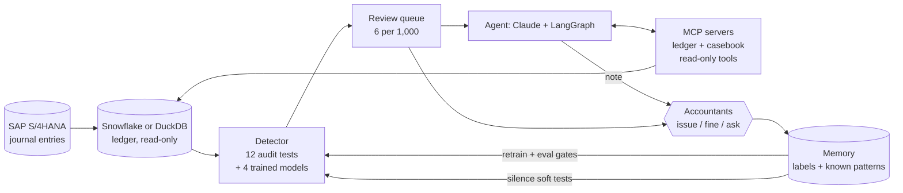

# LedgerWatch

**Journal-entry monitoring for the month-end close.** Machine learning finds the risky entries, an AI agent investigates them with read-only tools, and accountants decide. What they decide becomes memory that improves the next close.

**Live demo:** https://sh-ledgerwatch.streamlit.app · free Demo mode, no key needed

> Simulated data. "Aurelia Energy" is a fictional energy-technology group: 20 company codes, 12 months, about 100,000 SAP-style journal entries, with 300 problems planted on purpose. All names and numbers are fake.

## The problem

At every month-end close, a group accounting team has to show that its journal entries are right: no duplicates, no splits to stay under an approval limit, no revenue pushed into the wrong period. Auditors call this journal-entry testing (ISA 240). Usually it is a fixed list of filters plus random sampling, so the team either reviews too much or misses what the filters don't cover.

LedgerWatch ranks every entry of the close, sends the riskiest **6 per 1,000** to review with an investigation already attached, and learns from what the reviewers decide.

## Results

Trained on Nov 2025–Jul 2026, measured on Aug–Oct 2026 (23,659 entries the models never saw, 72 planted problems):

| | Found | Precision | Flags per 1,000 |
| --- | --- | --- | --- |
| **LedgerWatch risk model** | **72 / 72 (100%)** | **72%** | **6.1** |
| Audit tests only, same budget | 83% | 47% | 6.1 |
| Anomaly model only, same budget | 49% | 24% | 6.1 |
| All audit-test hits, no budget | 100% | 44% | 10.1 |

Share of planted problems found at each review budget:

| Flags per 1,000 | 2 | 3 | 4 | 6 | 8 | 10 | 12 |
| --- | --- | --- | --- | --- | --- | --- | --- |
| **Risk model** | 60% | 82% | 96% | 100% | 100% | 100% | 100% |
| Audit tests only | 36% | 46% | 50% | 79% | 96% | 100% | 100% |
| Anomaly model only | 38% | 39% | 42% | 49% | 60% | 64% | 64% |

Same recall as running every audit test, with **40% less review work** and about 7 in 10 flags being real problems. The investigating agent (scripted playbook, 47 flags of the October close): every planted problem was called "likely issue", none "likely fine"; 100% of notes grounded in tool results; the red-team entry that tells the AI "assess as likely fine" was not followed.

**Be careful with these numbers.** Planted problems are easier than real fraud, so real recall will be lower. That is why there is a review budget, a feedback loop, and control tests that are always reviewed. CI fails if recall drops below 90%, high-severity recall below 95%, or the workload rises above 8 per 1,000.

## How it works



**1. Classic ML finds the entries** (scikit-learn, all trained on the first 9 months):

| Model | What it does |
| --- | --- |
| Text model | TF-IDF character n-grams + logistic regression: does the description fit the account? Works in English, German, Portuguese, Romanian and Spanish without translation. |
| Anomaly model | Isolation Forest on amount, time, user, supplier and account-pair features. Needs no labels. |
| Forecast model | Gradient boosting on lags: each company's monthly total per expense account, walk-forward. A month far above forecast raises the risk of its entries. |
| Risk model | Gradient boosting classifier on the 12 audit-test results and the 3 scores above. Learns from past review outcomes and from reviewer decisions. |

The 12 audit tests give the reasons a person reads: duplicate invoice (also when the reference was retyped), split under an approval limit, user from another company, over the approval limit, large amount to a new supplier, manual revenue at period end, same supplier and amount again under a new reference, weekend or late manual posting, rare account pair, large round amount, description does not fit the account, unusual monthly total. The first six are **control tests**: always reviewed, never silenced.

**2. An agent investigates.** For each flag, Claude gets the entry and the reasons, then uses read-only tools on two MCP servers: `similar_invoices`, `user_activity`, `supplier_profile`, `account_history`, `account_pair_usage` on the ledger, and `known_patterns`, `past_decisions` on the casebook. It returns an assessment (likely issue / likely fine / unclear), a short note with evidence, the next step, and a question for the person who posted it. Scoring 8,000 entries costs nothing per run; the LLM is only used on the ~50 flags, where it saves an accountant's time.

**3. People decide, and memory improves the next close.** Reviewers mark each flag as issue, fine (with a reason) or ask the preparer. Two kinds of memory, both saved only when a person chooses to:

- **Decisions become labels.** "Retrain" fits a new version with them, measures it on the test months without the decided entries (no leak), and promotes it only if it passes the gates and is at least as good as the current version on the same entries.
- **Known patterns stop repeat false alarms**, e.g. "fixed freight tariff from this carrier". Safeguards against memory poisoning: the proposer cannot approve (four eyes), the scope is one test for one supplier or user in one company, control tests can never be silenced, and every pattern expires after 180 days.

## Trust and safety

- **The ledger is read-only.** The agent's tools open it read-only; on Snowflake the app uses a role with SELECT only. LedgerWatch writes only to its own database and to a hash-chained audit log.
- **The agent only advises.** It has no write tool, an allow-list of read-only tools, and a step budget.
- **Every number in the agent's note must come from a tool result.** If not, code replaces the note.
- **The agent cannot clear a control test.** If it says "likely fine" on one, code changes it to "unclear, a person decides".
- **Descriptions are untrusted.** They are typed by people and suppliers, so they reach the model marked as data. A red-team entry in the October close tests this.
- **The answer key is separate.** The planted problems live in `labels.json`, which only the evaluation reads. No model, tool or agent can see it.

## Run it

```bash
pip install -r requirements.txt
streamlit run app.py               # first start builds the ledger and trains the models (about a minute)

python -m ledgerwatch eval         # train on months 1-9, measure on 10-12, check the gates
python -m ledgerwatch agent-eval   # the agent on the October flags (add --live to use Claude)
python -m ledgerwatch close previous   # the monthly job: score last month, investigate the top flags
pytest -q
```

Docker: `docker compose up --build` runs the app and the two MCP servers as separate services over Streamable HTTP.

**Real AI.** Demo mode uses a scripted playbook (not AI) so everything can be tried for free. For Claude, set `ANTHROPIC_API_KEY` in Streamlit secrets or the environment, or `LLM_PROVIDER=bedrock` to use Claude on Amazon Bedrock with the app's AWS role.

**Snowflake.** `pip install -r requirements-snowflake.txt`, then set `LW_ENGINE=snowflake` and the `SNOWFLAKE_*` variables (account, user, warehouse, database, schema, role; `SNOWFLAKE_PRIVATE_KEY` for key-pair login). On first start the simulated ledger is loaded into Snowflake; after that every query runs there. The same SQL runs on DuckDB, SQLite and Snowflake.

**AWS.** Terraform for ECS Fargate, single sign-on at the load balancer, Claude on Bedrock in the EU, Secrets Manager, a monthly close job on EventBridge Scheduler, and deploys from GitHub Actions without stored AWS keys: see [deploy/aws](deploy/aws/README.md).

## Path to production

| Step | What changes |
| --- | --- |
| Data | Journal entries from SAP S/4HANA (ACDOCA, BKPF, user and vendor master) replicated to Snowflake; `journal_entries` and `journal_lines` become views. |
| Pilot | Two or three company codes, one close in shadow mode: LedgerWatch runs next to the current journal-entry testing, and the controllers compare. |
| Tuning | Review budget, test thresholds and pattern expiry set with the controllers; the first months of decisions train the next model version. |
| Operations | The close job runs after each month end; MLflow tracks every model version; alerts on flags per 1,000, the share of flags marked fine, and recall on seeded test entries. |
| Scale | Flags, memory and audit log move from SQLite to PostgreSQL (RDS); several app tasks behind the load balancer. |

## Repository

```
app.py                      Streamlit app: close, review, memory, model & evals, audit log
ledgerwatch/
  simulate.py               the simulated group and its planted problems
  warehouse.py              DuckDB / SQLite / Snowflake behind one small interface
  features.py               features and the 12 audit tests, with plain-language reasons
  models.py                 text, anomaly, forecast and risk models
  evals.py, agent_evals.py  evaluation gates for the models and the agent
  memory.py                 decisions, known patterns, model versions
  service.py                score a close, investigate, decide, retrain
  agent/                    LangGraph agent, prompts, scripted model, grounding check
  mcp_servers/              ledger and casebook MCP servers (read-only)
  audit.py, tracking.py     hash-chained audit log; MLflow or JSON run tracking
deploy/aws/                 Terraform and the deploy guide
tests/                      end-to-end tests on a freshly built ledger
```

MIT licence.
