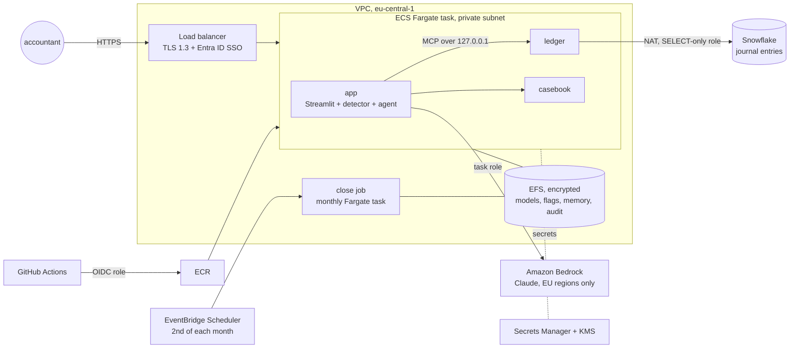

# Deploy LedgerWatch to AWS

Terraform for running LedgerWatch inside a company's AWS account: private network, company single sign-on, Claude on Amazon Bedrock in the EU, the ledger in Snowflake (or the demo ledger on EFS), a monthly close job, and deploys from GitHub Actions without stored AWS keys.



## What gets created

| Area | Resources | Why |
| --- | --- | --- |
| Network | VPC, 2 public + 2 private subnets, NAT gateway, S3 gateway endpoint, VPC flow logs, locked default security group | Tasks have no public IP; only the load balancer is reachable; every connection is logged |
| Entry | Application Load Balancer, HTTPS (TLS 1.3 policy), optional OIDC login | Company SSO (Entra ID, Okta) before any request reaches the app; `internal_alb = true` keeps it on the company network |
| Compute | ECS cluster, Fargate service, one task with 4 containers | The app, the 2 MCP servers as sidecars over Streamable HTTP on localhost, and an init container that prepares the data and model v1 |
| Close job | A second task definition and an EventBridge Scheduler schedule | After month end it scores the closed month and lets the agent investigate the top flags, so the queue is ready in the morning |
| Data | EFS (KMS-encrypted, TLS-only, access point, daily backup) | Models, flags, decisions, memory and the audit log survive restarts and redeploys |
| Ledger | `ledger_engine = "snowflake"` + `snowflake = {...}`, key in the secret | The ledger stays in Snowflake; the app's role needs SELECT only |
| Secrets | Secrets Manager (one JSON secret, KMS) | Snowflake private key, optional Anthropic key. Never in code, images or Terraform variables |
| AI | Task-role permission for Bedrock, Anthropic models only, EU regions only | No API key; model calls stay in the EU and show up in CloudTrail |
| Images | ECR, immutable tags, scan on push, keep the last 20 | The tag is the commit SHA, so every release can be traced to a commit |
| CI/CD | GitHub OIDC provider and a deploy role limited to one repo, one environment, one service | No AWS keys stored in GitHub |
| Operations | CloudWatch logs (KMS-encrypted, one year), Container Insights, alarms for "app down" and 5xx errors, SNS email | You find out before users do, and audits have the trail |

## Deploy in 5 steps

```bash
cd deploy/aws/terraform
cp backend.hcl.example backend.hcl            # S3 bucket for Terraform state
cp terraform.tfvars.example terraform.tfvars  # region, SSO, models, ledger, schedule
terraform init -backend-config=backend.hcl
terraform apply                               # about 10 minutes; the service starts with 0 tasks
terraform output github_variables
```

1. In GitHub: **Settings → Environments → New environment `dev`**. Add the values from `github_variables` as environment variables (and `APP_URL` for the smoke test). For `prod`, add required reviewers so a person approves every production deploy.
2. **Actions → deploy-aws → Run workflow.** It runs the tests and the eval gates, builds the image, pushes it to ECR with the commit SHA as the tag, registers new revisions of the app and close-job task definitions, rolls out, and waits until the service is healthy. A failed release is rolled back automatically.
3. For Snowflake: put the PEM private key in the secret named by `terraform output secret_name` (key `SNOWFLAKE_PRIVATE_KEY`), set `ledger_engine = "snowflake"` and the `snowflake` block, and apply again.

Check it: `terraform fmt`, `validate` and a Checkov security scan run in the `terraform` workflow on every change to this folder. Where a Checkov rule is skipped on purpose, the reason is written next to the resource as a `#checkov:skip` comment.

## Snowflake setup (once)

```sql
CREATE ROLE LEDGERWATCH_READER;
GRANT USAGE ON WAREHOUSE LEDGERWATCH_WH TO ROLE LEDGERWATCH_READER;
GRANT USAGE ON DATABASE FINANCE TO ROLE LEDGERWATCH_READER;
GRANT USAGE ON SCHEMA FINANCE.LEDGERWATCH TO ROLE LEDGERWATCH_READER;
GRANT SELECT ON ALL VIEWS IN SCHEMA FINANCE.LEDGERWATCH TO ROLE LEDGERWATCH_READER;
GRANT SELECT ON FUTURE VIEWS IN SCHEMA FINANCE.LEDGERWATCH TO ROLE LEDGERWATCH_READER;
CREATE USER LEDGERWATCH_APP DEFAULT_ROLE = LEDGERWATCH_READER RSA_PUBLIC_KEY = '<public key>' TYPE = SERVICE;
GRANT ROLE LEDGERWATCH_READER TO USER LEDGERWATCH_APP;
```

In production `journal_entries`, `journal_lines`, `users`, `suppliers`, `accounts` and `company_codes` are views over the SAP tables replicated to Snowflake (ACDOCA/BKPF, user and vendor master). To try it with the simulated data instead, give the role write access to the schema once: the init container loads the demo ledger on first start.

## Choices and trade-offs

- **Sidecars, not separate services.** The two MCP servers are small, so one task keeps it simple and cheap, and the traffic stays on localhost. When other agents share them (for example a ledger server used by close, audit and tax agents), move them to their own ECS service behind Service Connect; the app only changes its `MCP_URLS`.
- **One task and SQLite on EFS.** Right for a department and a demo. A deploy stops the old task before starting the new one (a short downtime). For several tasks: flags, memory and audit move to RDS PostgreSQL.
- **Training inside the app.** Retraining takes about 15 seconds on 75,000 entries, so it runs in the task. With a real group's volume, move it to a SageMaker training job or a Snowpark container and keep the same eval gates.
- **Bedrock instead of an API key.** Access is the task's IAM role, limited to Anthropic models in EU regions. Set `bedrock_model_ids` to the model or inference-profile ids enabled in your account.
- **Who decides.** The ALB adds the signed-in user to each request (`x-amzn-oidc-data`). The next step is to read it in the app and map Entra ID groups to reviewer and approver roles, instead of the demo's "Acting as" selector.

## Rough cost (eu-central-1, one task always on)

Around 120–140 USD per month: Fargate (1 vCPU, 4 GB) about 50, NAT gateway about 35 plus data, load balancer about 20, and a few dollars for EFS, KMS, Secrets Manager, logs and the monthly job. Bedrock and Snowflake are pay per use. Check the AWS Pricing Calculator for your region. `terraform destroy` removes it all (in prod, turn off the load balancer's deletion protection first).
