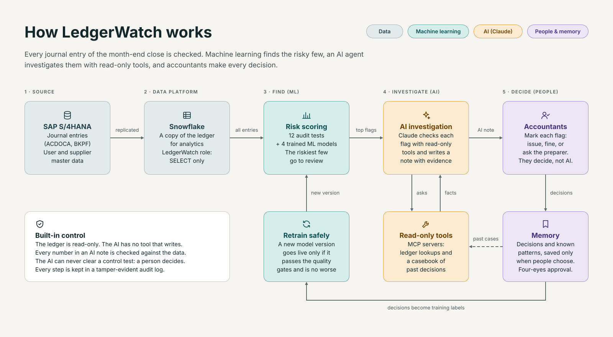
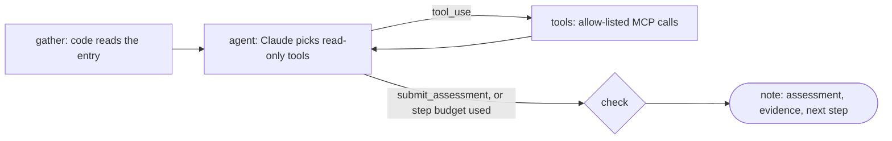
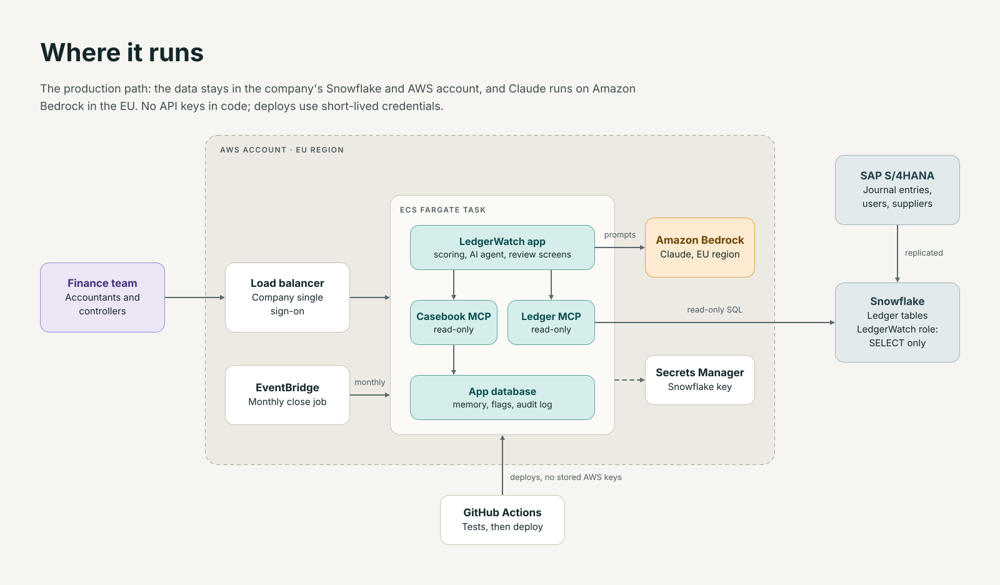

# Architecture

## The flow

1. **Source.** Journal entries come from SAP S/4HANA: the header (BKPF) and the debit/credit lines (ACDOCA), plus the
   user and supplier master data. In the demo, `simulate.py` builds the same shape for a fictional group.
2. **Data platform.** The ledger lives in Snowflake (or DuckDB / SQLite for local runs). LedgerWatch connects with a
   role that can only `SELECT`. `warehouse.py` keeps one small interface, so the same SQL runs on all three engines.
3. **Find (machine learning).** `features.py` runs 12 audit tests and builds features. `models.py` adds four trained
   models: text vs account, anomaly, monthly forecast and the risk model that combines everything. The riskiest
   entries, up to the review budget (`LW_FLAGS_PER_1000`), become flags with plain-language reasons.
4. **Investigate (AI).** For the top flags, a Claude agent (`agent/graph.py`) reads the entry and calls read-only tools
   on two MCP servers. It returns an assessment, evidence, a next step and a question for the preparer.
5. **Decide (people).** Accountants mark each flag issue, fine or ask. Their decisions, and the known patterns they
   choose to save, are the memory (`memory.py`). Memory feeds a gated retrain and silences approved soft tests.

## The agent graph

- **gather**: code, not the model, loads the entry through the ledger MCP server and adds the detector's reasons.
- **agent**: one Claude call per step. Descriptions and references reach the model wrapped as untrusted data. After
  `LW_MAX_AGENT_STEPS` steps it must submit.
- **tools**: only tools on the allow-list run. None of them write.
- **check**: every number in the note must appear in a tool result, or code replaces the note with a plain one. If a
  control test fired, "likely fine" becomes "unclear": a person decides.

Without LangGraph installed, a small runner in the same file follows the same edges.

## The two MCP servers

| Server | Tools | Reads |
|---|---|---|
| `ledger` | `get_entry`, `similar_invoices`, `user_activity`, `supplier_profile`, `account_history`, `account_pair_usage` | the ledger, read-only |
| `casebook` | `known_patterns`, `past_decisions` | the app's memory, read-only |

They run as stdio subprocesses by default, or as separate Streamable HTTP services (`MCP_URLS`, used by
`docker-compose.yml` and the AWS task).

## Memory and retraining

- **Decisions** are labels. `Retrain` fits a new version on the training months plus these labels (weighted 3x), then
  measures it on the test months without the entries people decided, so nothing leaks.
- A new version is **promoted only if** it passes the gates (recall, high-severity recall, workload) and is at least
  as good as the current version on the same entries. Otherwise it is saved but not used.
- **Known patterns** silence one soft test for one supplier or user in one company. Four eyes, 180-day expiry,
  revocable. Control tests can never be silenced.

## Where it runs

| Piece | Local / Docker | Public demo (Streamlit Cloud) | Company setup (AWS) |
|---|---|---|---|
| App | `streamlit run app.py` or the `app` container | Streamlit Cloud | ECS Fargate, single sign-on at the load balancer |
| MCP servers | subprocesses, or two containers over HTTP | subprocesses | sidecar containers in the same task |
| Ledger | DuckDB file | DuckDB file, rebuilt on start | Snowflake, SELECT-only role |
| Claude | API key, or the scripted demo model | shared key with a spend cap, or demo mode | Amazon Bedrock in the EU, IAM role |
| Memory and audit log | SQLite files | SQLite files (lost on restart) | SQLite on EFS; PostgreSQL (RDS) to scale |
| Monthly close job | `python -m ledgerwatch close previous` | not used | EventBridge Scheduler runs the same command |
| Deploy | - | push to `main` | GitHub Actions with OIDC, no stored AWS keys |

Terraform and the step-by-step guide: [deploy/aws](../deploy/aws/README.md).

## Audit log

Every tool call, model call, assessment, decision and pattern change is written to `audit.db`. Each row holds the hash
of the row before, so a changed or deleted row breaks the chain. The app's Audit log tab checks it on every view.

More: [model card](model_card.md) · [data card](data_card.md) · [decision records](adr/)
